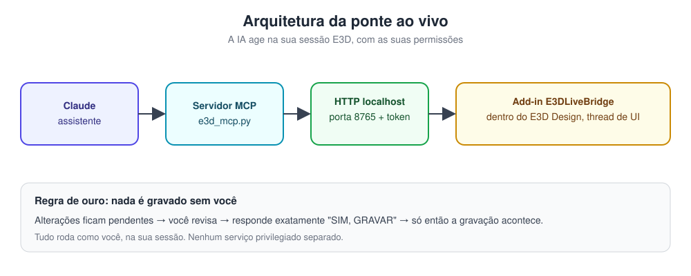
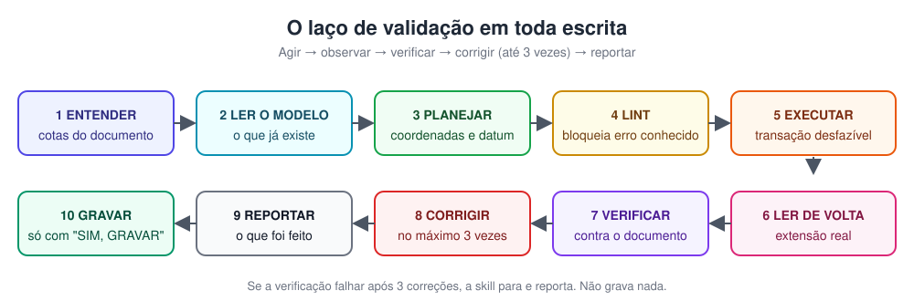
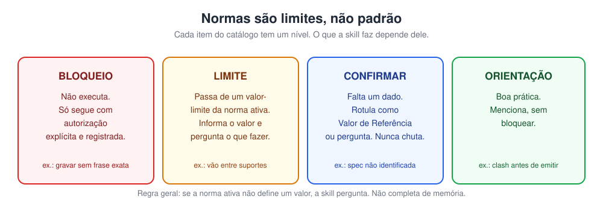
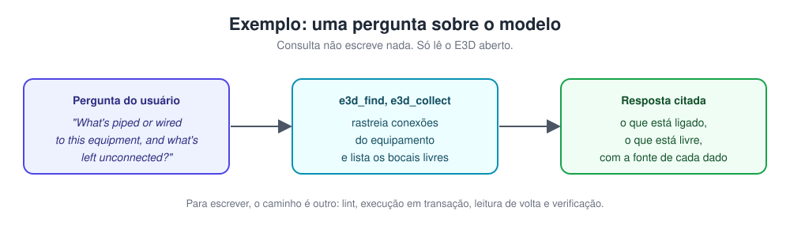

# AVEVA E3D — skill para Claude com validação em loop

Uma skill para o Claude consultar, planejar e modelar plantas industriais no **AVEVA Everything3D (E3D)**, com dois ganhos principais: **normas que impedem erros de modelagem** e **validação em loop** quando a ponte com o E3D aberto estiver instalada.

> **Status:** em desenvolvimento. O código foi testado com uma ponte simulada (7 testes passando). **Ainda não foi testado no E3D real.** Veja [O que ainda não foi verificado](#o-que-ainda-não-foi-verificado).

---

## Como funciona



O Claude conversa com o servidor MCP, que fala com um add-in dentro do seu E3D Design aberto. Ele age com as suas permissões e a sua sessão. Nada é gravado sem a sua confirmação.

## O laço de validação



Toda escrita passa pelo mesmo caminho. Se a verificação falhar depois de três correções, a skill para e reporta. Não grava nada.

## Normas são limites, não padrão



A skill não traz um padrão de empresa. Cada item do catálogo tem um nível:

- **BLOQUEIO**: não executa sem autorização explícita e registrada.
- **LIMITE**: passa de um valor-limite da norma ativa. A skill informa e pergunta.
- **CONFIRMAR**: falta um dado. A skill rotula como *Valor de Referência* ou pergunta.
- **ORIENTAÇÃO**: boa prática, sem bloqueio.

O catálogo completo está em [`references/normas-de-referencia.md`](references/normas-de-referencia.md).

## Exemplo de consulta



Consulta só lê. Para escrever, o caminho é outro.

---

## Estrutura do repositório

```
SKILL.md                      instruções para o Claude
references/
  normas-de-referencia.md     catálogo de limites (N-01 a N-23)
  ponte-ao-vivo.md            protocolo de execução
  fonte-all3d-mcp.md          o que é público sobre o all3D-MCP
  instalacao-e-teste.md       roteiro de instalação e testes
  origem.md                   de onde veio cada parte
server/                       servidor MCP (Python) e lint de PML
bridge/                       add-in C# para o E3D e script de build
tests/                        testes do laço, contra a ponte simulada
install.ps1                   instalação no Windows
docs/images/                  diagramas deste README
```

## Requisitos

- Windows com AVEVA E3D Design instalado e licenciado (a API `Aveva.Core.*` é usada pelo add-in).
- Python 3.10 ou mais recente, com `mcp` (`pip install "mcp>=1.12,<2"`).
- Para o add-in: .NET Framework e o caminho da instalação do E3D.

## Instalação

1. Feche o E3D se estiver aberto.
2. Rode, numa janela do PowerShell:

   ```powershell
   powershell -ExecutionPolicy Bypass -File install.ps1 -AvevaDesignExe "<pasta do E3D>"
   ```

3. Abra o E3D Design. O console deve mostrar `[E3DLiveBridge] ouvindo em http://localhost:8765/`.
4. Conecte o servidor MCP ao Claude. O roteiro completo está em [`references/instalacao-e-teste.md`](references/instalacao-e-teste.md).

**Use um projeto de treino, nunca um projeto de produção, nos primeiros testes.**

## Como usar

Peça ao Claude, em linguagem natural, algo como:

- "Quais linhas estão ligadas a este equipamento e o que ficou sem conexão?"
- "Confira o comprimento e a elevação deste ramal contra o isométrico que estou mandando."
- "Crie a válvula conforme a especificação da zona, mas não grave ainda."

O Claude responde com o que encontrou e, quando for escrita, mostra as mudanças pendentes. Para gravar, responda exatamente **SIM, GRAVAR**.

---

## O que ainda não foi verificado

- Nenhum teste no E3D real. Os itens marcados **[TESTAR-E3D]** continuam abertos.
- O add-in C# foi compilado só contra stubs, nunca contra a API real da AVEVA.
- `install.ps1` e `build.ps1` nunca rodaram no Windows.

Se você testar e encontrar algo, abra uma issue. Isso é exatamente o que falta.

## Comente, pergunte, proponha

Este repositório existe para ser usado e discutido.

- **Dúvida de uso:** abra uma [Discussion](../../discussions) na categoria Q&A.
- **Erro ou comportamento estranho:** abra uma issue com o passo a passo, a versão do E3D e a mensagem de erro exata.
- **Nova norma ou regra de modelagem:** abra uma issue com a fonte. Sem fonte, a regra fica como CONFIRMAR.
- **Resultado de teste no E3D:** comente com a versão do E3D e o resultado de cada item do roteiro. Isso fecha os [TESTAR-E3D].

## Licença e fontes

- Código e documentos deste repositório: **MIT**. Veja [LICENSE](LICENSE).
- A licença **não cobre** o software AVEVA E3D, PDMS ou MDS. Esses são produtos e marcas de seus donos.
- O comportamento público do all3D-MCP usado como referência está descrito em [`references/fonte-all3d-mcp.md`](references/fonte-all3d-mcp.md). Nenhum código ou material do all3D foi copiado.
- Veja [`references/origem.md`](references/origem.md) para a origem de cada parte.
